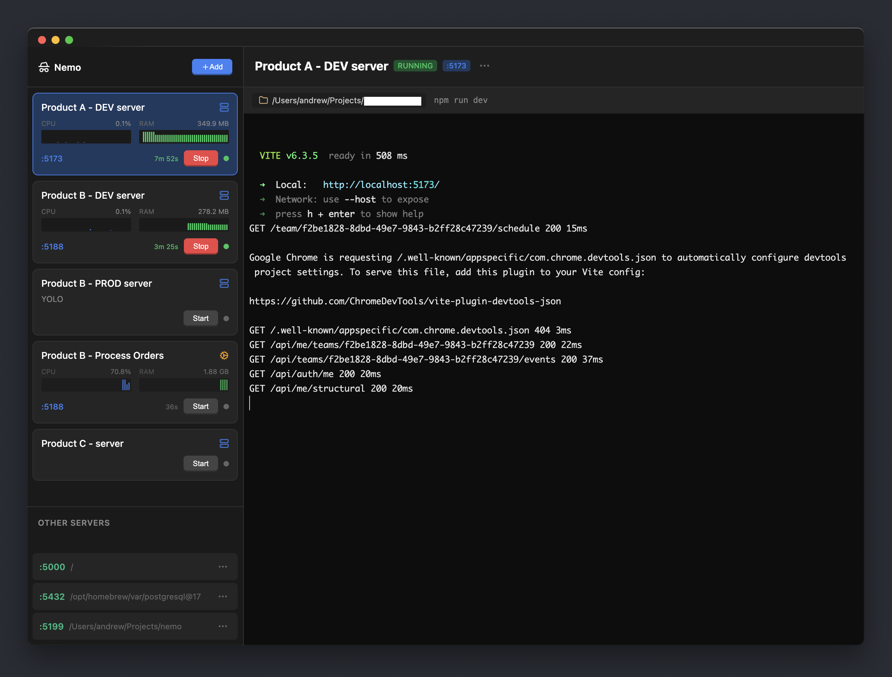

# Nemo

A simple Electron-based process manager for running and monitoring local terminal processes.



## Features

- Add, edit, and delete process configurations
- Start/stop processes with a single click
- Live terminal emulator with full PTY support
- Real-time CPU and memory monitoring
- Auto-restart option for servers that crash
- Support for long-running servers, one-time jobs, and scheduled tasks (every few minutes or daily at a set time)

## Process Types

- **Servers** run until you stop them. Nemo detects the port from terminal output and can restart a server automatically if it crashes.
- **Jobs** run a command once and show a notification when it finishes.
- **Scheduled tasks** run a command automatically, either every N minutes (2 to 60) or once a day at a set time. Intervals align to the local clock, so a 5-minute task runs at :00, :05, :10, and so on. Each task's card shows a countdown to its next run, and you can still start one manually at any time.

Notes on scheduled tasks:

- They run only while Nemo is open. Runs missed while the app is closed are skipped. If the Mac sleeps through one or more runs with Nemo open, the task runs once on wake.
- If a run is still going when the next one is due, the new run is skipped.
- Daily tasks notify when they finish. Interval tasks don't, to avoid a notification every few minutes.
- Times use the Mac's local timezone.

## Development

```bash
# Install dependencies
bun install

# Run in development mode
bun run electron:dev

# Or run separately:
bun run dev          # Start SvelteKit dev server
bun run electron:build && ./node_modules/.bin/electron .  # Start Electron
```

## Building

```bash
# Build for production
bun run dist
```

This creates distributable packages in the `release/` directory.

### Launching on macOS without a terminal

```bash
bun run dist:mac
```

This creates a double-clickable `Nemo.app` under `release/`. Open it from Finder or drag it into `/Applications`. When Nemo is running, macOS shows a menu bar item with the number of running server processes.

If macOS blocks a task from writing to a folder or drive, grant Nemo access in **System Settings > Privacy & Security > Files and Folders**. For projects on external drives, network volumes, or other protected locations, grant Nemo **Full Disk Access** in the same Privacy & Security section.

## Data Storage

All data is stored in JSON files in the Electron user data directory:

- **macOS**: `~/Library/Application Support/nemo/nemo-data/`
- **Linux**: `~/.config/nemo/nemo-data/`
- **Windows**: `%APPDATA%/nemo/nemo-data/`

Files:

- `processes.json` - Process configurations
- `metrics.json` - Historical CPU/memory metrics
- `port-history.json` - Port usage history for conflict detection

## Tech Stack

- [Electron](https://www.electronjs.org/) - Desktop app framework
- [SvelteKit](https://kit.svelte.dev/) - Frontend framework
- [node-pty](https://github.com/microsoft/node-pty) - Pseudo-terminal support
- [xterm.js](https://xtermjs.org/) - Terminal emulator
- [pidusage](https://github.com/soyuka/pidusage) - Process metrics

## License

MIT
